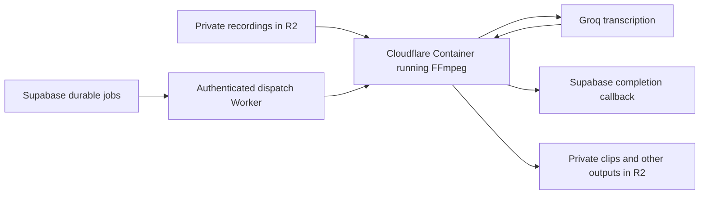

# Remove the Render subscription

- **Author:** Codex for Test4Test
- **Date:** 2026-10-27
- **Status:** Deployed; production uses Cloudflare, and Render compute is suspended without ongoing service charges

Implementation status, checks, deployment instructions, and rollback are tracked
in [implementation.md](./implementation.md).

## Overview

Move Test4Test's remaining media processor to compute that runs only when work is queued. The first choice is Cloudflare Containers because Test4Test already uses Cloudflare for its website and recording storage, and the user participates in Cloudflare for Students. Keep Groq for transcription and Supabase for job state, access checks, and completion records. Remove screenshot generation from the workload. After the replacement passes validation, retire the Render service and its recurring charges.

The student offer waives the Workers Paid base fee of $5/month for 12 months; usage beyond included allowances remains chargeable. Workers Paid and Containers access are verified, and the owner confirmed receipt of the student-redemption email. After the offer, retaining Workers Paid costs $5/month at current prices; otherwise the account reverts to Free. [Student offer](https://www.cloudflare.com/students/), [Containers availability](https://developers.cloudflare.com/containers/)

Google Cloud Run Jobs is the strongest alternative if avoiding that base fee after the student year is the priority. Its recurring free compute allowance is larger. However, if Test4Test will keep Workers Paid for its website anyway, allocating its whole $5 fee to the media processor would overstate the migration cost. The recommendation is conditional on total incremental cost, not the largest advertised credit.

Separately recording audio in the browser could reduce future processing, but it should be a later optimization. It cannot replace processing for existing recordings, manually uploaded videos, and downloadable clips by itself.

Existing uploads, transcripts, private playback, public clips, and short feedback previews must continue working. The user explicitly excludes screenshots. The proposed implementation also stops generating recording-card thumbnails and replaces their presentation dependency, while preserving the video recordings themselves.

## Analysis

### What still needs processing

The Render service downloads recordings, extracts and splits audio with FFmpeg, calls Groq, and returns timestamped transcripts. It also exports clipped MP4s and generates recording thumbnails. Groq performs speech recognition; it does not perform Test4Test's clip exports. Removing screenshot and thumbnail work therefore reduces the workload but does not eliminate the processor.

The upload limit is 1 GiB, and accepted formats include MP4, MOV, and WebM. A read-only aggregate of current, undeleted `test_responses` recordings on October 27 found:

| Format | Recordings | Over 25 MB | Over 100 MB |  Largest |
| ------ | ---------: | ---------: | ----------: | -------: |
| WebM   |         53 |         40 |          14 | 245.8 MB |
| MOV    |          7 |          5 |           3 | 814.6 MB |
| MP4    |          6 |          6 |           6 | 828.3 MB |
| Total  |         66 |         51 |          23 | 828.3 MB |

These are decimal MB and current response records, not a monthly workload estimate or an inventory of every historical version. No recording content was read for this aggregate.

A separate read-only aggregate found 26 ready transcripts completed in the preceding 30 days. Only five have `duration_ms` populated, so their summed duration cannot represent total audio hours. No measured processing CPU, peak RAM, or export traffic is available yet. This is a small observed job count, not proof of a zero monthly bill.

Groq accepts supported files through a URL and can handle MP4 and WebM directly. Its documented total file limits are 25 MB on Free and 100 MB on Developer; attachments are limited to 25 MB. MOV is absent from the documented supported formats. Therefore, replacing the entire processor with direct Groq calls would leave existing supported cases uncovered. [Groq speech-to-text documentation](https://console.groq.com/docs/speech-to-text)

### Where audio can be prepared

| Approach                  | How it works                                                                                  | Main tradeoff                                                                                            | Proposed role                                                              |
| ------------------------- | --------------------------------------------------------------------------------------------- | -------------------------------------------------------------------------------------------------------- | -------------------------------------------------------------------------- |
| Cloudflare Containers     | Run the existing Node and native FFmpeg processor in a container that sleeps between jobs.    | Student waiver covers the base fee for one year; lifecycle and resource sizing need work.                | First candidate given the existing Cloudflare stack and student benefit.   |
| Google Cloud Run Jobs     | Run a container task to completion for each job or bounded batch.                             | New deployment and identity setup; local temporary files consume RAM; outbound transfers can cost extra. | Best alternative for a larger recurring free compute allowance.            |
| Modal Functions           | Wrap the media task in a function with native FFmpeg and a suitable container image.          | New provider and Python deployment wrapper around the current Node task need a prototype.                | Generous recurring credit, but more integration work.                      |
| Azure Container Apps Jobs | Execute a container when work arrives.                                                        | Additional account and deployment setup; student eligibility and renewal apply.                          | Credible student alternative, with little reason to add a third cloud now. |
| AWS Lambda                | Package native FFmpeg in an event function.                                                   | Standard invocations have a 15-minute maximum; large exports need careful sizing or job splitting.       | Alternative for bounded extraction jobs.                                   |
| Browser audio recording   | Record the microphone into a separate audio file alongside the screen video.                  | Requires capture, upload, retry, and timing changes; does not cover manual uploads or old recordings.    | Later optimization.                                                        |
| Browser extraction        | Use a media demuxer or FFmpeg compiled to WebAssembly to extract audio from an uploaded file. | Codec coverage, memory, battery, and tab lifetime become user-device concerns.                           | Optional acceleration after testing, never the only fallback.              |
| Direct Groq request       | Send a short-lived URL for a compatible file within the account limit.                        | Larger files and unsupported formats still need preparation.                                             | Optional fast path.                                                        |

Cloudflare Containers can run software requiring a filesystem and Linux runtime. Cloud Run Jobs charge for task instance lifetime with a one-minute minimum and permit configurable task timeouts. Lambda charges for requests and runtime, with a standard invocation limit of 15 minutes. [Cloudflare Containers](https://developers.cloudflare.com/containers/), [Cloud Run pricing](https://cloud.google.com/run/pricing), [Cloud Run task timeouts](https://docs.cloud.google.com/run/docs/configuring/task-timeout), [Lambda pricing](https://aws.amazon.com/lambda/pricing/), [Lambda quotas](https://docs.aws.amazon.com/lambda/latest/dg/gettingstarted-limits.html)

Modal's function deployment model is primarily Python, although its JavaScript SDK can invoke deployed functions. A thin wrapper could launch the existing Node task; this is a proposed adaptation, not a verified drop-in migration. [Modal Functions](https://modal.com/docs/guide/functions)

Simply moving native FFmpeg into an ordinary Supabase Edge Function or the website's existing Cloudflare Worker is not the proposed approach. Their constrained runtimes are better suited to authorization and dispatch: Supabase documents 256 MB memory and two seconds of CPU per request; Workers document 128 MB memory per isolate. [Supabase limits](https://supabase.com/docs/guides/functions/limits), [Workers limits](https://developers.cloudflare.com/workers/platform/limits/)

### Recommended first migration

Keep the current media algorithms and replace their host. This avoids simultaneously changing recording capture, transcription inputs, clip encoding, and infrastructure.

The dispatch Worker is a separate media service, preserving the website deployment. Pass job identifiers and authorized storage references rather than large video bodies through it. The container streams the recording to temporary disk, processes it, stores outputs in R2, and calls the existing completion endpoints.

Retain durable claims, renewable leases, attempt identifiers, bounded retries, and deletion checks in Supabase. An interrupted container must leave a recoverable job. Treat its local queue and temporary disk as disposable.

The current HTTP handler returns 202 while processing continues in the background. Container sleep must track real queued and running work, including provider calls and completion acknowledgements; an idle HTTP connection is not proof that the job has finished. Let the container sleep only after all work settles. Cloudflare documents ephemeral disk and configurable inactivity shutdown. [Container lifecycle FAQ](https://developers.cloudflare.com/containers/faq/)

Do not wake a container on every empty cron run or health probe. Claim eligible work first and wake it only when there is work. Begin with one active media job at a time, then size CPU, memory, and temporary disk using representative recordings. Retain current media thread limits until measurements justify changing them.

If Cloud Run wins the benchmark instead, introduce a task entrypoint that processes a claimed job, acknowledges completion, and exits. The existing HTTP 202 response plus background queue is not that execution contract. Dispatch executions through an authenticated backend using least-privilege Google identity. Its writable filesystem consumes instance memory, so a near-1-GiB input plus audio, clip outputs, and FFmpeg buffers cannot be sized like an ordinary disk-backed server. Benchmark with sufficient RAM and bounded temporary files rather than selecting the smallest free-looking instance. [Cloud Run filesystem](https://docs.cloud.google.com/run/docs/container-contract#filesystem)

### Capture audio directly as a later optimization

The native recorder already has a microphone stream before it combines audio and video. A second `MediaRecorder` could write just those audio tracks to a private audio file while the existing recorder continues producing the full recording. Choose a supported audio format at runtime and upload the result to R2 alongside its source and version. [MediaRecorder constructor](https://developer.mozilla.org/en-US/docs/Web/API/MediaRecorder/MediaRecorder)

At an illustrative 64 kbit/s, 30 minutes of audio is approximately 14.4 MB before container overhead. Browser-selected bitrate can differ, so verify actual size. Send the completed audio through the backend to Groq; keep API credentials on the server. [MediaRecorder bitrate](https://developer.mozilla.org/en-US/docs/Web/API/MediaRecorder/audioBitsPerSecond)

Validate synchronized start, pause, resume, and stop behavior so word timestamps still match the video. A missing or failed audio upload should trigger extraction from the saved video without invalidating that video. Audio files inherit source deletion and access rules and should be cleaned up after processing according to an explicit retry policy.

Do not send arbitrary `dataavailable` blobs to Groq as independent files: the recording specification does not guarantee that each blob is playable. Assemble the complete audio file, or deliberately produce independently valid chunks with recorded offsets. [MediaStream Recording specification](https://www.w3.org/TR/mediastream-recording/)

For manual uploads, extracting an already compressed audio track without re-encoding may be worth exploring. It requires format-aware parsing and Groq-compatible output. General FFmpeg in the browser is a weaker default: its maintainers document slower execution than native FFmpeg and higher resource use with multiple threads. [FFmpeg WebAssembly FAQ](https://github.com/ffmpegwasm/ffmpeg.wasm/blob/main/apps/website/docs/faq.md)

### Keep clips; remove screenshot processing

Keep clip exports and 15-second feedback previews on the replacement processor. A player that merely seeks within the full recording does not preserve the current public-clip boundary: a guest with the full video URL could retrieve material outside the approved clip.

Remove obsolete screenshot-report and recording-thumbnail work from the migration scope. Current Analytics code displays generated thumbnails, upload completion enqueues them, and preview retrieval can schedule missing thumbnails. Stop enqueueing, dispatching, retrying, and polling those jobs, and give affected cards an approved neutral presentation. Removing only the worker endpoint would leave failed jobs and unnecessary polling. This is planned interface work and must follow the repository design-system workflow when implemented.

Keep actual clip exports and short feedback preview videos: they are video access features, not screenshots. Existing completed outputs do not need regeneration. Do not bulk-delete stored media as part of this hosting change; any obsolete-image cleanup should have a separate verified inventory and retention decision.

### Costs and the strongest objection

Published allowances checked October 27, 2026:

| Candidate                                   | Included compute or credit                                                                                                                               | Fit for this project                                                                                       |
| ------------------------------------------- | -------------------------------------------------------------------------------------------------------------------------------------------------------- | ---------------------------------------------------------------------------------------------------------- |
| Cloudflare Containers with the student plan | 375 vCPU-minutes, 25 GiB-hours memory, and 200 GB-hours disk monthly; base fee waived during the student year.                                           | Likely low incremental cost at the observed job count, subject to measurement. Uses the existing platform. |
| Google Cloud Run Jobs                       | 240,000 vCPU-seconds and 450,000 GiB-seconds monthly, based on us-central1 pricing and shared across the billing account.                                | Larger recurring allowance, with no student expiry attached to that allowance.                             |
| Modal Starter                               | $30 of compute credit each month; no base subscription fee.                                                                                              | Attractive allowance, but requires a new account and integration.                                          |
| Azure for Students / Container Apps         | $100 credit usable over 12 months; eligible students can renew. Container Apps separately includes 180,000 vCPU-seconds and 360,000 GiB-seconds monthly. | Viable if already using Azure; account eligibility and ancillary charges still matter.                     |

[Cloudflare pricing](https://developers.cloudflare.com/containers/platform/pricing/), [Cloud Run pricing](https://cloud.google.com/run/pricing), [Modal pricing](https://modal.com/pricing), [Azure student offer](https://azure.microsoft.com/en-us/free/students/), [Azure Container Apps billing](https://learn.microsoft.com/en-us/azure/container-apps/billing)

These are resource allowances, not hours of recorded video. Cloudflare charges provisioned memory and disk while running, but CPU according to active use; sleep stops container charges. Worker, Durable Object, logging, and network usage must also be counted. Google charges allocated resources for the task lifetime, including a one-minute minimum, and internet transfers have a separate small free allowance. Build and registry costs also belong in the estimate.

For scale, 100 jobs each taking two billed minutes at 1 vCPU and 4 GiB would consume 12,000 vCPU-seconds and 48,000 GiB-seconds. Those quantities fit inside Cloud Run's published allowance if other workloads have not used it. This is an illustrative processing-time scenario, not a forecast or a chosen production size.

Email evidence shows a Google Cloud payment and billing reinstatement in October 2026, so Google is an existing account option; its present dashboard state and other usage remain unverified. Earlier DigitalOcean and Heroku termination emails do not establish usable current hosting.

The strongest objection is that engineering and maintenance could cost more than the subscription savings. First compare the actual Render invoice with measured replacement costs. Keep browser audio capture out of the critical migration path unless it produces a demonstrated benefit.

Target zero incremental media-compute charges at today's small observed workload, with a measured low overage budget as it grows. Groq transcription and existing storage costs remain. None of these offers establishes a zero-cost system. Do not add GPU hosting for speech recognition when Groq already performs it.

## Goals vs Non Goals

**In scope:** remove Render's recurring service cost and unnecessary screenshot/thumbnail generation; preserve supported uploads, transcripts, timestamps, clip privacy, feedback previews, retry behavior, and source deletion; verify total replacement cost and recovery from interruptions.

**Out of scope:** change transcription providers, remove clips or previews without a product decision, reduce the upload limit, bulk reprocess existing media, or require a tester to leave a tab open for backend work.

## Key Decisions and Staging for Next Steps

1. **Confirm account costs and remove unnecessary work.** Read the current Render invoice, Cloudflare student redemption/expiry, and existing Workers usage. Inventory the deployed Render revision and settings; the local checkout may differ. Identify and remove screenshot/thumbnail callers and their queue/UI dependencies together.
2. **Prototype a portable replacement container.** Package the remaining Node/FFmpeg processor and deploy a separate authenticated media entrypoint on Cloudflare Containers. Keep R2, Groq, Supabase schemas, and completion contracts intact. Ensure idle shutdown waits for actual job completion. Compare measured total cost with Cloud Run Jobs before committing to the host.
3. **Benchmark representative cases.** Use authorized fixtures covering MP4, MOV, WebM, VP9, high resolution, no audio, long audio requiring chunks, and files approaching the existing 1 GiB limit. Measure memory, disk, runtime, idle duration, failures, and total billed resources. Test a job longer than the inactivity timeout.
4. **Prove reliability and privacy.** Interrupt a job, restart the container, expire a lease, repeat a dispatch, and delay a callback. Verify one authoritative completion. Test source deletion during processing, clip revocation, private preview access, and derived-file cleanup. Reuse the existing worker and integration tests.
5. **Switch a controlled cohort.** Record the selected processor for each attempt so both hosts cannot claim the same work. Switch new attempts to the replacement while existing Render attempts settle. Keep a routing rollback switch during validation.
6. **Retire Render.** Require successful transcript and clip journeys, recovery tests, acceptable cost, and no remaining calls to Render across normal and scheduled paths. Drain its work, retain the reproducible deployment configuration, remove the billable service and any other chargeable Render resources, and verify billing actually stops. A quiet dashboard alone is insufficient.
7. **Optimize only if warranted.** Add separate browser audio capture and direct Groq routing for compatible small inputs. Keep the replacement processor for uploads, old recordings, and clips.

The leading hypothesis is Cloudflare Containers under the existing student benefit, conditional on the account entitlement and benchmarks. Cloud Run Jobs is the preferred alternative if avoiding a future Workers base fee or obtaining a larger recurring allowance outweighs the extra integration. Modal and Azure are credible options, but adding another provider merely to consume credits is unlikely to be the most effective first move. No service has been deployed or cancelled by this research.

## Repository References

- [Recording capture](C:/Projects/Test4Test-Redesign/src/pages/TestSessionPage.tsx:2967)
- [Upload limits and formats](C:/Projects/Test4Test-Redesign/src/lib/recordings.ts:9)
- [Audio extraction and Groq calls](C:/Projects/Test4Test-Redesign/services/video-processor/src/transcription.ts:92)
- [Durable transcript dispatch](C:/Projects/Test4Test-Redesign/supabase/functions/dispatch-recording-transcripts/index.ts:5)
- [Clip processing](C:/Projects/Test4Test-Redesign/services/video-processor/src/clipProcessor.ts:105)
- [Feedback previews](C:/Projects/Test4Test-Redesign/supabase/functions/_shared/feedback-preview.ts:16)
- [Analytics thumbnails](C:/Projects/Test4Test-Redesign/src/pages/AnalyticsPage.tsx:40)
